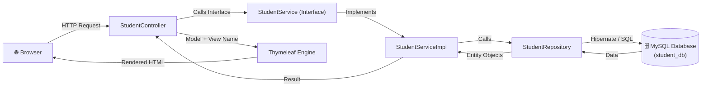

# 📚 Student Management System

A full-stack, web-based **Student Management System** developed using **Spring Boot**, **Spring Data JPA**, **Thymeleaf**, and **MySQL**, styled with **Bootstrap 5**.

Built for academic project evaluation (FA 1 & FA 2), adhering to clean architecture, standard OOP design patterns, input validation, and global exception handling.

---

## 🛠️ Tech Stack

- **Backend Framework:** Spring Boot 3.2.5 (Java 17+)
- **ORM / Persistence:** Spring Data JPA / Hibernate
- **Database:** MySQL 8.x
- **Template Engine:** Thymeleaf
- **UI & Styling:** Bootstrap 5 (CDN)
- **Build Tool:** Apache Maven (with included Maven Wrapper `mvnw.cmd` / `./mvnw`)

---

## ✨ Features

### 🔹 FA 1: Foundation & Core CRUD
- **Student Registration:** Add new students with Full Name, Email, Course, Total Fee, and Paid Fee.
- **Dynamic Fee Balance Calculation:** Computes `totalFee - paidFee` dynamically without redundant database storage.
- **Conditional Styling:** Balance displays in **green** when fully cleared and **red** when fees are pending.
- **Students Table:** Displays student records with responsive table layout and total record count.
- **Database Auto-Mapping:** Hibernate auto-manages schema updates (`ddl-auto=update`).

### 🔹 FA 2: OOP Refactoring, Advanced Modules & Robustness
- **Object-Oriented Programming (OOP) Principles:**
  - **Inheritance:** `@MappedSuperclass Person` base class contains common personal attributes (`name`, `email`). `Student` extends `Person` using constructor chaining (`super(name, email)`).
  - **Abstraction:** `StudentService` is defined as an interface that outlines the business contract without exposing implementation details.
  - **Polymorphism / Method Overriding:** `StudentServiceImpl` provides concrete implementations of the interface methods (`@Override`).
  - **Encapsulation:** Private attributes accessed through public getter and setter methods.
- **Search Module:** Case-insensitive search bar filtering students by **Name** or **Course** using custom JPQL (`GET /students?keyword=...`).
- **Edit & Pay Fee Module:** Update student details or increment `paidFee` when fees are deposited (`GET /students/edit/{id}` & `POST /students/update/{id}`).
- **Delete Module:** Delete student records with client-side JavaScript confirmation dialog (`GET /students/delete/{id}`).
- **Input Validation:**
  - Enforced in both Controller and Service layers.
  - Ensures Name, Email, and Course are non-empty.
  - Prevents negative fee inputs (`totalFee < 0` or `paidFee < 0`).
  - Disallows `paidFee > totalFee`.
  - Displays user-friendly red Bootstrap alerts (`alert-danger`) on the form with the exact error message.
- **Global Exception Handling:**
  - Custom `StudentNotFoundException`.
  - `@ControllerAdvice GlobalExceptionHandler` intercepts missing record lookups and runtime errors, rendering a custom `error.html` page with a **"Back to Student List"** shortcut.

---

## 🏛️ Architecture & Request Flow (MVC)



---

## 📁 Project Structure

```
student-management/
├── .mvn/                                      # Maven Wrapper binaries & configs
├── src/
│   └── main/
│       ├── java/com/college/studentmanagement/
│       │   ├── StudentManagementApplication.java  # Main Spring Boot entry point
│       │   ├── controller/
│       │   │   └── StudentController.java         # Web request handlers & page navigation
│       │   ├── entity/
│       │   │   ├── Person.java                    # Base class (@MappedSuperclass) - Inheritance
│       │   │   └── Student.java                   # JPA entity extending Person
│       │   ├── exception/
│       │   │   ├── GlobalExceptionHandler.java    # @ControllerAdvice error interceptor
│       │   │   └── StudentNotFoundException.java  # Custom runtime exception
│       │   ├── repository/
│       │   │   └── StudentRepository.java         # Spring Data JPA repository with JPQL search
│       │   └── service/
│       │       ├── StudentService.java            # Service interface (Abstraction)
│       │       └── impl/
│       │           └── StudentServiceImpl.java    # Concrete service (Polymorphism)
│       └── resources/
│           ├── application.properties             # MySQL & Hibernate configuration
│           └── templates/
│               ├── add-student.html               # Student registration form
│               ├── edit-student.html              # Edit student & fee update form
│               ├── error.html                     # Custom error fallback page
│               └── students-list.html             # Student table with search & actions
├── .gitignore                                 # Git ignore file for build & IDE artifacts
├── mvnw                                       # Maven wrapper script (Unix)
├── mvnw.cmd                                   # Maven wrapper script (Windows)
├── pom.xml                                    # Maven dependencies & build configuration
└── README.md                                  # Project documentation
```

---

## 🚀 Getting Started Locally

### Prerequisites
- **Java Development Kit (JDK):** Version 17 or higher
- **MySQL Server:** Version 8.x running on `localhost:3306`

---

### Step 1: Create the MySQL Database
Open your MySQL Command Line Client or MySQL Workbench and run:

```sql
CREATE DATABASE student_db;
```

---

### Step 2: Configure Database Credentials
Open `src/main/resources/application.properties` and verify your MySQL password:

```properties
spring.datasource.url=jdbc:mysql://localhost:3306/student_db
spring.datasource.username=root
spring.datasource.password=YOUR_MYSQL_PASSWORD
```

---

### Step 3: Run the Application

Using the included Maven Wrapper:

- **On Windows (PowerShell / Command Prompt):**
  ```powershell
  .\mvnw.cmd spring-boot:run
  ```

- **On macOS / Linux:**
  ```bash
  ./mvnw spring-boot:run
  ```

---

### Step 4: Access the Application

Open your browser and navigate to:
👉 **[http://localhost:8080](http://localhost:8080)** (automatically redirects to `/students`)

---

## 📌 URL Endpoints Reference

| HTTP Method | URL Path | Action / Description | Template / View |
| :--- | :--- | :--- | :--- |
| `GET` | `/` | Root redirect | Redirects to `/students` |
| `GET` | `/students` | View all students (or filter by keyword) | `students-list.html` |
| `GET` | `/students?keyword=...` | Search students by Name or Course | `students-list.html` |
| `GET` | `/students/add` | Display blank student registration form | `add-student.html` |
| `POST` | `/students/save` | Validate & save a new student | Redirects to `/students` |
| `GET` | `/students/edit/{id}` | Display edit form with pre-filled student details | `edit-student.html` |
| `POST` | `/students/update/{id}` | Validate & update student details or paid fee | Redirects to `/students` |
| `GET` | `/students/delete/{id}` | Delete student record by ID | Redirects to `/students` |

---

## 🎓 Viva Key Takeaways

1. **Why `@MappedSuperclass`?**
   It allows `Student` to inherit persistent fields (`name`, `email`) from `Person` without generating a separate table or requiring foreign key joins in MySQL.
2. **Why `StudentService` Interface?**
   Enforces Abstraction and Loose Coupling. The Controller interacts solely with the interface, keeping business logic swappable and testable.
3. **How does Search work?**
   Utilizes JPQL (`@Query`) with `LOWER()` and `LIKE` to match either `name` or `course` in a case-insensitive manner.
4. **How are errors handled?**
   - **Form input errors:** Handled gracefully on the page via red Bootstrap alert blocks (`alert-danger`).
   - **System / ID lookup errors:** Captured globally by `@ControllerAdvice` (`GlobalExceptionHandler`), routing users to `error.html`.
